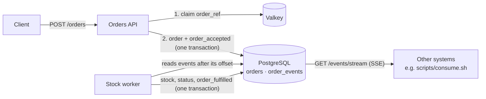

# Orders & Stock API

A small FastAPI service for a grocery store. It accepts orders, applies them to
stock with a background worker, and publishes order events that other systems
can stream. Data lives in PostgreSQL; Valkey is a fast first check for duplicate
orders.

## Prerequisites

| Requirement | Version | Used for |
|---|---|---|
| [Docker](https://docs.docker.com/get-docker/) with Compose v2 (`docker compose`) | Tested on Docker 29.8, Compose 5.5 | Runs Postgres and Valkey |
| [Python](https://www.python.org/downloads/) | 3.12+ (`.python-version` pins 3.12.9) | The API and scripts |
| [Poetry](https://python-poetry.org/docs/#installation) | 2.x (tested on 2.5.1) | Dependencies and virtualenv |
| bash and curl | bash 3.2+ | The `scripts/*.sh` helpers |
| Free local ports | 5433, 6380, 8000 | Postgres, Valkey, API (changeable in `.env`) |

macOS and Linux work as-is. On **Windows, use [WSL](https://learn.microsoft.com/windows/wsl/install)**
and run everything inside it.

## Quick start

```bash
./scripts/init-env.sh     # optional: create .env from .env.example to change ports/credentials
./scripts/up.sh           # start Postgres + Valkey, install dependencies, migrate, seed
./scripts/serve.sh        # run the API on http://localhost:8000 (docs: /docs)
```

In a second terminal:

```bash
./scripts/sim-all.sh      # reset, then run both unhappy-path simulations (PASS/FAIL)
./scripts/test.sh         # pytest suite (uses its own database; your data is untouched)
./scripts/consume.sh      # watch order events arrive live (Ctrl+C to stop)
```

If Postgres or Valkey are already running on those ports, `up.sh` reuses them
rather than starting new containers.

## How it maps to the brief

| Requirement | Where |
|---|---|
| Accept an order and store it in PostgreSQL | `POST /orders` |
| Same `order_ref` counted only once | Valkey claim, then Postgres unique constraint. `sim-duplicates.sh`, `test_concurrent_duplicates_count_once` |
| Order total from prices at the time of the order | Each line stores its unit price. `test_prices_are_fixed_at_order_time` |
| Create an order, fetch details and status | `POST /orders`, `GET /orders/{id}`, `GET /orders/{id}/status`, `GET /orders` |
| Seed products and a burst of orders with duplicates | `python -m app.seed`, `python -m scripts.burst` |
| Accept orders while stock is unavailable; catch up after | Stock is applied by a worker, not at intake. `sim-stock-outage.sh` |
| Persist in PostgreSQL, not only in memory | Orders, events, worker position and pause flag are all in Postgres |
| Stock reduced when an order is accepted | Stock worker (`app/stock_worker.py`) |
| Read current stock for a SKU | `GET /products/{sku}/stock` |
| **Option A**: let other systems consume accepted orders | `GET /events/stream` (Server-Sent Events) and `scripts/consume.sh` |

## The two unhappy paths

**1. Duplicate submissions:** `./scripts/sim-duplicates.sh`
Sends 13 requests for 6 order refs at the same instant, including repeats with
the same body (client retries) and one with a different body. PASS means every
ref was created exactly once, every duplicate got `409`, and stock went down once
per created order.

**2. Stock outage with catch-up:** `./scripts/sim-stock-outage.sh`
Pauses the stock worker, which stands in for the stock side being unavailable,
then submits orders. These include rice (no stock) and more avocados than are
left. PASS means:
- every order was accepted (`201 pending`) while stock stayed untouched and the
  backlog held them,
- after resuming, the worker caught up and every status, supplied quantity,
  charge and stock level matches a first-come-first-served replay,
- nothing was missed, nothing was applied twice, and no stock went below zero.

You can also pause and resume by hand:

```bash
poetry run python -m scripts.stock_worker pause    # or: resume, status
```

## Design



- **Postgres is the source of truth; Valkey is a fast first check.** A
  duplicate whose order is already cached is rejected without touching the
  database. Anything else, including Valkey being down, falls through to
  Postgres's unique constraint on `order_ref`, which settles races correctly.
- **Outbox instead of doing stock work inline.** Intake writes the order and an
  `order_accepted` event in one transaction and returns `201`, so orders are
  never lost or rejected because stock is unavailable.
- **One event log, several consumers (the Kafka model on Postgres).** The stock
  worker and external systems read the same `order_events` log, each tracking
  its own position.
- **Exactly-once stock.** The worker deducts stock, records what was supplied,
  appends `order_fulfilled` and advances its offset in one transaction, so a
  crash means a retry, never a double deduction.
- **Partial fulfilment, not backorders.** Groceries can't be backordered. Each
  line gets `min(requested, available)`, the customer is charged only for what
  was supplied, and stock never goes negative. The order ends `confirmed`,
  `partially_fulfilled` or `unfulfilled`.
- **Prices fixed at order time.** Unit prices are copied onto each line when the
  order is accepted, so later price changes don't affect it.
- **SSE for the feed.** It's plain HTTP (`curl -N` works), and clients resume
  with `Last-Event-ID` after a disconnect, so a consumer that was offline
  doesn't miss anything.

## Trade-offs and limits

- **Event appends are serialised.** Event ids are assigned at insert but become
  visible at commit, so without care a reader could skip an event that commits
  late. Writers take a short Postgres lock from the event insert until commit,
  so ids become visible in order. That caps event-writing throughput; in
  production a change-data-capture tool (e.g. Debezium) would provide commit
  order without the lock.
- **At-least-once delivery.** Consumers should ignore event ids they've already
  processed (the example consumer does).
- **Instant wake-ups are per process.** The worker and SSE streams are woken
  in-process when an event is written. With several API instances, others pick
  it up on their next poll (about a second).
- **The event log is kept forever.** Any consumer can replay from the start.
  Retention would be the next thing to add.
- **Open streams are closed on shutdown.** `serve.sh` gives them three seconds,
  and SSE clients reconnect and resume.
- **The Valkey fallback isn't demonstrated.** Orders keep working (and
  duplicates are still caught) when Valkey is down, but that isn't presented as
  a third unhappy path, since the brief asks for exactly two.

## Out of scope, on purpose

Authentication, product management, substitutions, and payments. For payments,
the natural fit is to reserve the requested total at intake and capture only
what was fulfilled. Input validation (unknown SKUs, bad pagination cursors)
returns sensible errors but isn't demonstrated.

## API

Interactive docs are at **http://localhost:8000/docs**.

| Method | Path | Purpose |
|---|---|---|
| `POST` | `/orders` | Accept an order (`201 pending`), or `409` for a duplicate `order_ref` |
| `GET` | `/orders` | List orders, newest first, cursor-paginated (`?limit=&cursor=`) |
| `GET` | `/orders/{id}` | Full order: lines, supplied quantities, charge, status |
| `GET` | `/orders/{id}/status` | Just the status |
| `GET` | `/products/{sku}/stock` | Current stock for a SKU |
| `GET` | `/events/stream` | Order events as Server-Sent Events (`?after=` or `Last-Event-ID` to resume) |
| `GET` | `/health` | Postgres and Valkey status (`degraded` if only Valkey is down) |

Money is in whole cents. Order statuses: `pending`, `confirmed`,
`partially_fulfilled`, `unfulfilled`.

```bash
curl -s -X POST localhost:8000/orders -H 'content-type: application/json' \
  -d '{"order_ref":"ORD-1","customer_id":"c1","items":[{"sku":"BAN-001","qty":2}]}'
curl -N localhost:8000/events/stream
```

## Scripts

| Script | What it does |
|---|---|
| `init-env.sh` | Create `.env` from `.env.example` (`--force` replaces it, keeping a backup) |
| `up.sh` | Start Postgres + Valkey, `poetry install`, migrate, seed |
| `serve.sh` | Run the API with auto-reload |
| `reset.sh` | Wipe orders and events, restore products, clear Valkey, reseed |
| `sim-duplicates.sh` | Unhappy path 1 |
| `sim-stock-outage.sh` | Unhappy path 2 |
| `sim-all.sh` | Reset, then both simulations, with a summary |
| `consume.sh` | Example consumer of the event stream (`--from-start` replays everything) |
| `test.sh` | pytest suite (extra arguments go to pytest) |
| `down.sh` | Stop Postgres + Valkey (`--wipe` also deletes their data) |

## Configuration

All settings are optional; the defaults work with `docker-compose.yml`. Copy
`.env.example` to `.env` with `./scripts/init-env.sh` and edit it. Variables set
in your shell take precedence over `.env`.

| Setting | Default | |
|---|---|---|
| `POSTGRES_USER` / `POSTGRES_PASSWORD` / `POSTGRES_DB` | `admin` / `admin` / `offerzen-db` | Used when the database is first created |
| `POSTGRES_PORT`, `VALKEY_PORT`, `API_PORT` | `5433`, `6380`, `8000` | Local ports |
| `DATABASE_URL`, `VALKEY_URL` | built from the above | Full URLs, if you'd rather set those |

`.env.example` lists the tuning settings (poll intervals, cache TTLs, timeouts).

## Project layout

```
app/
  routers/       HTTP endpoints (thin)
  controllers/   request logic
  resources/     database access
  models/        SQLAlchemy tables      schemas/   request/response models
  stock_worker.py   cache_sync.py   event_bus.py
migrations/      Alembic migrations
scripts/         setup, simulations, consumer, worker control
tests/           pytest suite (isolated test database)
```

## AI usage

This project was built with the help of an AI coding assistant (Claude, via
Claude Code). I directed the work, made the product and design decisions, and
reviewed and tested the results. The assistant wrote most of the code, tests,
scripts and documentation to that direction, and flagged issues along the way.

Decisions I made include:
- Postgres as the source of truth, with Valkey as a fast first check
- new orders start `pending`
- partial fulfilment rather than backorders, since groceries can't be backordered
- Option A with Server-Sent Events
- `created_at`/`updated_at` on every table
- limiting the demos to exactly the two unhappy paths
- Docker for Postgres and Valkey only, with the API run through Poetry

Bugs found and fixed during review and testing include:
- events that could be skipped under concurrent writes
- false `409`s from a stale Valkey claim
- a deadlock between reset and the stock worker
- open event streams blocking server shutdown
