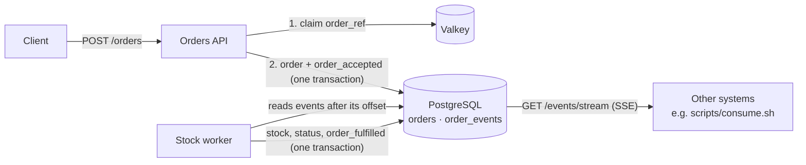

# Solution: design and trade-offs

This document explains how the Orders and Stock API works, why I built it this
way, what I considered and rejected, and where its limits are. To run it, see
the [README](README.md).

## Overview

Customers place grocery orders. Each order must count once, be priced at the
moment it's placed, and be accepted even when the stock side is briefly
unavailable. Stock has to catch up afterwards, and other systems need to hear
about accepted orders.

My approach in one line: **intake only records the order, and everything else
happens afterwards from an event log in Postgres.**

| Component | Role |
|---|---|
| PostgreSQL | Source of truth: products, orders, the event log, and each consumer's position in it |
| Valkey | A fast first check for duplicate `order_ref`s. Losing it never loses data |
| Stock worker | A background task in the API process. It applies accepted orders to stock |
| Event stream | `GET /events/stream`, Server-Sent Events read from the same log |

## 1. Order intake and duplicates

An order can arrive more than once with the same `order_ref`, through client
retries, double clicks or a burst of the same request. Only one may count. I
used three layers, from fastest to most certain:

1. **Valkey claim.** `SET order:<ref> pending NX` with a 30-second expiry. If the
   key already holds the *committed order* (its JSON), the request is a known
   duplicate and gets `409` without touching the database.
2. **Postgres lookup.** If the ref is already in `orders`, return `409` and copy
   the order back into Valkey so the next duplicate is caught at step 1.
3. **Unique constraint on `order_ref`.** This settles any race that gets past
   the first two steps. Two concurrent inserts for the same ref: one commits,
   and the other gets an `IntegrityError`, which becomes a `409`.

**Why Postgres is the source of truth, not Valkey.** Valkey is in memory and can
restart empty, so it can't be the thing that decides whether an order exists.
It's there to keep obvious duplicates off the database. If Valkey is down,
intake logs a warning and relies on Postgres alone. Orders keep working and
duplicates are still caught. A background loop (`app/cache_sync.py`) copies
orders from Postgres back into Valkey once it's reachable again. It tracks a
watermark and re-checks a small window below it, because ids can commit out of
order.

**A bug I found here: false `409`s.** At first, any existing key counted as a
duplicate, including a `pending` claim. If a request claimed a ref and then
crashed before committing, retries were rejected for 30 seconds even though no
order existed. Now only a committed order in Valkey counts as proof. A
`pending` claim means "unsure, ask Postgres." The claim returns one of three
states (`claimed`, `exists`, `unclaimed`), and
`test_stale_pending_claim_does_not_cause_a_false_409` covers it.

**Alternatives I didn't take:**
- *Postgres only.* Simpler and correct, but every duplicate in a burst costs a
  database round trip. The Valkey check is cheap insurance for order storms.
- *Valkey only.* Faster, but a Valkey restart would forget orders and let
  duplicates through.

## 2. Pricing at order time

Each line stores its `unit_price_cents` when the order is accepted, and the
total comes from those. A later price change doesn't touch existing orders
(`test_prices_are_fixed_at_order_time`). Unknown SKUs are rejected with `422`.

Money is stored as **integer cents**. The first migration used a float for
`price_cents`, which can't represent amounts like 0.10 exactly, so I migrated
it to `INTEGER` with a non-negative check.

## 3. Stock, the outbox, and catch-up

The brief says orders must be accepted while stock is unreachable, and stock
must catch up afterwards. My first version deducted stock inside the order
transaction, which meant a stock failure failed the order. So I split them.

**Intake (the outbox).** `POST /orders` inserts the order (`pending`) and an
`order_accepted` row in `order_events` in one transaction, then returns `201`.
Stock isn't touched. If the stock side is down, nothing is lost: the event
waits in the log.

**The stock worker.** It reads `order_events` in id order, which is first come,
first served, from its saved position in `consumer_offsets`. For each order it
does all of the following in **one transaction**:

- locks the order and its products, in SKU order so two workers can't deadlock;
- fulfils each line with `min(requested, available)` and deducts exactly that;
- sets the supplied quantities, the charge and the status;
- appends an `order_fulfilled` event;
- advances its offset past the event.

Because the deduction and the offset move together, each event is applied
**exactly once**. A crash before commit rolls back both, and the event is
retried. A crash after commit has already moved the offset.

**Simulating the outage.** The brief says a pause and resume is enough, so
`consumer_offsets.paused` stands in for the stock side being unavailable. It's
stored in Postgres, so the CLI (`python -m scripts.stock_worker pause`) and the
simulation can flip it while the API is running.

**Alternatives I didn't take:**
- *A background thread or task started from the controller per order.* It's
  quick to write, but the work lives in memory. A crash or restart loses it,
  and nothing records what's been applied. The brief says not to rely on
  in-memory state.
- *A real broker (Kafka, RabbitMQ).* It's the production answer, but it means
  another service to run and a dual-write problem: the order commits but the
  publish fails, or the other way round. The outbox gets the same model (an
  append-only log plus consumer offsets) inside Postgres, where the order and
  its event commit together.

## 4. Partial fulfilment instead of backorders

What happens when there isn't enough stock? My first instinct was to keep the
order but set the short item's quantity to 0 and charge 0 for it. I looked at
how event-driven systems handle this (reserve, then confirm or reject, the saga
pattern), and the deciding factor was the domain: **groceries can't be
backordered**. Nobody wants milk delivered three weeks late.

So each line is fulfilled with whatever is on the shelf:

| Supplied | Status | Charge |
|---|---|---|
| Everything | `confirmed` | full total |
| Some | `partially_fulfilled` | only what was supplied |
| Nothing | `unfulfilled` | 0 |

Stock never goes below zero. The order keeps both `qty` (requested) and
`fulfilled_qty` (supplied), so you can always see what was short.

**Alternatives I didn't take:**
- *Reject the whole order.* That fails the "accept orders" requirement, and it's
  a poor experience when one item out of ten is short.
- *Backorder (allow negative stock).* That's wrong for perishables, and it hides
  the shortage.

## 5. Option A: the event stream

Of the two options, I chose **A (an integration surface)** over B (a daily
report). It reuses the event log I already needed for stock, and storage for
the log isn't a concern at this scale.

`GET /events/stream` serves the log as **Server-Sent Events**: every
`order_accepted` and `order_fulfilled` event, with its id. `scripts/consume.sh`
is the tiny consumer the brief asks for. It prints each event and saves its
position to a file, so restarting it neither misses nor repeats events.

**Why SSE rather than WebSockets or plain polling:**
- The data only flows one way, server to client. WebSockets add a two-way
  protocol I don't need.
- It's plain HTTP, so `curl -N` works and proxies don't need special handling.
- Resuming is built in: a client that reconnects sends `Last-Event-ID` and
  carries on from there. That's the same model as a polling endpoint with an
  `after` cursor, and `?after=` works too.

Delivery is **at-least-once**. Consumers skip ids they've already handled, as
the example consumer does.

**A bug I found here: skipped events.** Postgres assigns an event's id at
insert, but other sessions only see the row at commit. If transaction A gets id
10 and B gets id 11, and B commits first, a reader sees 11 and moves its cursor
past 10. When A commits a moment later, 10 is behind every cursor and is never
delivered. That applies to the stock worker as well as to the stream. I
reproduced it with a deliberately slow writer, and fixed it by having every
event append take a transaction-level advisory lock
(`pg_advisory_xact_lock`), so ids become visible in the order they were
assigned. `test_slow_writer_cannot_make_the_worker_skip_an_event` covers it.

**Alternative I didn't take:** filtering readers by transaction snapshot
(`pg_snapshot_xmin`). That avoids the lock, but it has edge cases around
long-running transactions that I couldn't fully close in the time I had. The
lock is simple and obviously correct; its cost is listed under trade-offs.

## 6. The two unhappy paths

The brief asks for exactly two, so I demonstrated exactly two and left other
edge cases (such as Valkey being down) handled but not showcased.

1. **Duplicate submissions** (`./scripts/sim-duplicates.sh`). This sends 13
   simultaneous requests for 6 refs, including retries with the same body and
   one with a different body. It passes if each ref is created once, every
   duplicate gets `409`, and stock drops once per created order.
2. **Outage with catch-up** (`./scripts/sim-stock-outage.sh`). This pauses the
   worker and submits orders, including rice (none in stock) and more avocados
   than are left. It checks that every order is accepted and still `pending`,
   stock is untouched and the backlog holds them. Then it resumes the worker
   and checks that every status, supplied quantity, charge and stock level
   matches a first-come-first-served replay. It also checks that nothing was
   missed or applied twice, and that no stock went below zero.

## 7. Trade-offs and limits

- **Event appends are serialised.** The advisory lock is held from each event
  insert until its transaction commits, which caps how fast events can be
  written. In production I'd use change data capture (e.g. Debezium reading
  the write-ahead log), which delivers events in commit order without a lock.
- **Instant wake-ups only work within one process.** The worker and the SSE
  streams are woken in-process as soon as an event is written. With several API
  instances, the others pick it up on their next poll, about a second later.
  Postgres `LISTEN/NOTIFY` would fix that.
- **The worker runs inside the API process.** That's fine for this exercise. In
  production it would be its own process so it can scale and be deployed
  separately. The offset row lock already makes it safe to run more than one.
- **The event log is never trimmed.** Any consumer can replay from the start.
  Retention or archiving would come next.
- **Valkey is a cache, not a lock service.** A claim that expires in the middle
  of a request only costs a database check, never a duplicate order, because
  the unique constraint decides.
- **Open streams are closed on shutdown.** The server gives them three seconds,
  then clients reconnect and resume.

## 8. Out of scope, on purpose

- Authentication.
- Product management (products come from the seed).
- Substitutions.
- Payments. The natural fit with partial fulfilment is to authorise the
  requested total at intake and capture only what was supplied.

## 9. What I'd do next

1. Move event publishing to change data capture and remove the lock.
2. Run the stock worker as its own process.
3. Add event retention.
4. Add metrics: backlog size, consumer lag, the duplicate rate.
5. Add authentication, and payments as described above.

## 10. Testing

`./scripts/test.sh` runs a pytest suite against its own database
(`<POSTGRES_DB>_test`) and Valkey database 1, so your data is untouched. Each
test starts from a clean state.

| Test | Covers |
|---|---|
| `test_concurrent_duplicates_count_once` | Concurrent duplicates create one order |
| `test_duplicate_with_different_body_is_still_rejected` | The ref, not the body, decides |
| `test_stale_pending_claim_does_not_cause_a_false_409` | Regression: the false `409` bug |
| `test_prices_are_fixed_at_order_time` | Price changes don't affect existing orders |
| `test_orders_accepted_while_stock_is_down_then_catch_up` | Outage and catch-up |
| `test_short_stock_is_partially_fulfilled_and_never_negative` | Partial fulfilment |
| `test_slow_writer_cannot_make_the_worker_skip_an_event` | Regression: the skipped-event bug |

I checked both regression tests by putting each bug back and confirming the
test fails.
